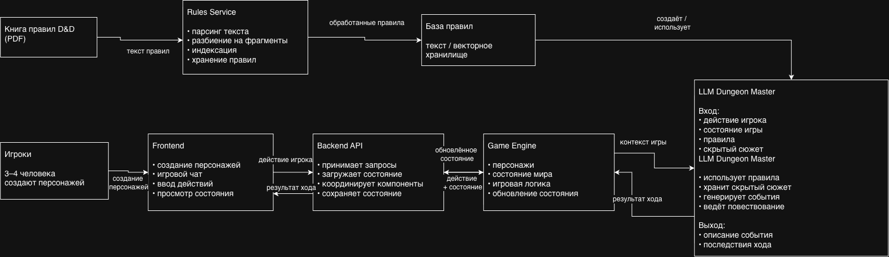
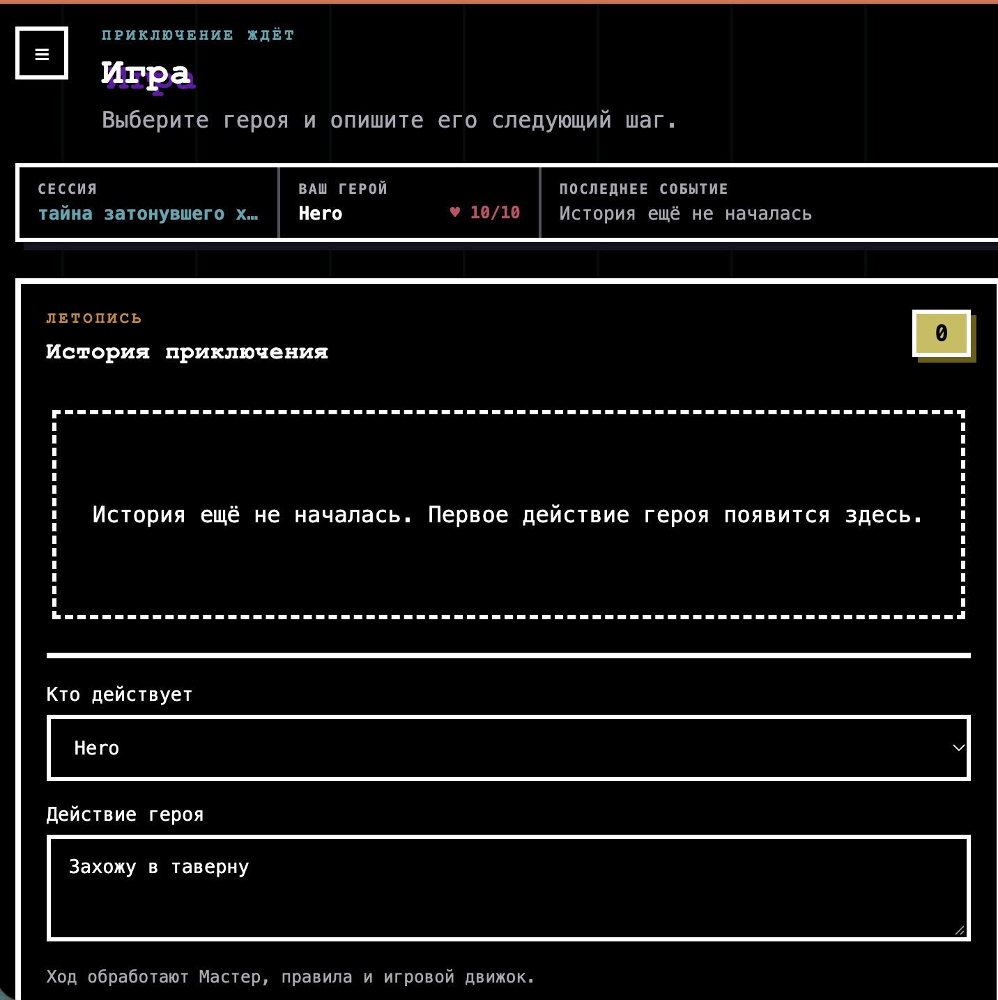

# AI Dungeon Master

AI Dungeon Master — веб-приложение для текстовой настольной RPG с LLM в роли ведущего. Игрок создаёт игровую сессию, отправляет действия персонажа и получает повествование и обновлённое состояние мира.

> **Статус:** рабочая интеграция Frontend, Backend, Game Engine и оркестратора. Для ходов с реальной LLM требуется доступный API-провайдер и квота. Создание персонажей через UI, постоянное хранение сессий и полноценная многопользовательская игра пока не реализованы.

## Архитектура



```text
Browser / Frontend
       |
       v
Backend (FastAPI, sessions, state, history)
       |
       v
TurnOrchestrator
  |        |             |
  v        v             v
Rules   AI Dungeon    Game Engine
Service    Master     (validation and state updates)
```

- **Frontend:** браузерный интерфейс на HTML/CSS/JavaScript; создание и выбор сессии, отправка ходов, отображение персонажей, мира и истории.
- **Backend / Application:** REST API, создание сессий, хранение текущего состояния и истории в памяти процесса, координация компонентов.
- **TurnOrchestrator:** проверка действия, запрос релевантных правил, вызов Dungeon Master, преобразование ответа в команды Game Engine.
- **AI Dungeon Master:** генерация повествования и структурированных последствий хода через OpenAI-совместимый API.
- **Rules Service:** извлечение правил из локального документа; режим `keyword` позволяет обойтись без загрузки embedding-модели.
- **Game Engine:** детерминированное применение структурированных команд, валидация, обновление характеристик и игрового мира.

## Игровой ход

1. Игрок отправляет действие через Frontend.
2. Backend находит сессию и создаёт `PlayerAction` с ожидаемой ревизией состояния.
3. Оркестратор проверяет действие, получает правила и вызывает AI Dungeon Master.
4. Структурированные последствия ответа преобразуются в команды Game Engine.
5. Game Engine валидирует и атомарно применяет команды.
6. Только при принятом ходе Backend обновляет состояние и историю, а Frontend отображает результат.

Если Rules Service недоступен, оркестратор может продолжить ход без дополнительных правил. Если AI Dungeon Master не отвечает, ход завершается ошибкой, а состояние не сохраняется как успешное.

## Локальный запуск

Требуется Python 3.13 (используемая в разработке версия). Frontend не требует сборки.

```bash
python3 -m venv .venv
source .venv/bin/activate
python -m pip install -r requirements.txt
cp .env.example .env
```

Укажите в `.env` собственный ключ провайдера (`OPENAI_API_KEY`). **Не добавляйте `.env` и токены в Git.** Для Hugging Face Router нужны доступная модель и квота Inference Providers.

Запуск Backend:

```bash
uvicorn backend.main:app --reload --port 8000
```

В отдельном терминале запустите Frontend:

```bash
python -m http.server 5500 --directory frontend
```

Откройте `http://127.0.0.1:5500`. Если в вашей ветке есть `run.sh`, можно использовать его вместо двух терминалов после проверки содержимого скрипта.

## Конфигурация

| Переменная | Назначение |
|---|---|
| `OPENAI_API_KEY` | Ключ OpenAI-совместимого API (например, Hugging Face) |
| `OPENAI_BASE_URL` | URL API провайдера |
| `MODEL_NAME` | Идентификатор модели |
| `RULES_BOOK_PATH` | Путь к документу правил |
| `RULES_MODE` | Режим поиска правил (`keyword` для локальной разработки) |

Образец настроек: [`.env.example`](.env.example). Указанная там модель — пример конфигурации; её доступность зависит от провайдера и квоты.

## API

| Метод | Путь | Назначение |
|---|---|---|
| `GET` | `/health` | Проверка доступности Backend |
| `POST` | `/sessions` | Создание сессии (`name`) |
| `GET` | `/sessions/{session_id}/state` | Публичное состояние сессии |
| `POST` | `/sessions/{session_id}/turns` | Игровой ход (`character_id`, `text`) |
| `POST` | `/sessions/{session_id}/actions` | Техническое применение изменения HP (`character_id`, `text`, `health_delta`) |

Интерактивная документация FastAPI: `http://127.0.0.1:8000/docs`.

## Тестирование

```bash
python -m unittest discover -s backend/tests -p 'test_*.py' -v
python -m unittest discover -s integration/tests -p 'test_*.py' -v
```

Тесты Frontend (если установлен Node.js):

```bash
npm run test:frontend
```

## Текущие ограничения

- Сессии и история находятся в оперативной памяти Backend и теряются после перезапуска сервера.
- Создание персонажей в интерфейсе пока недоступно; новая сессия получает тестового героя.
- Для реальных ответов Dungeon Master требуется внешний API; ошибки доступа или квоты провайдера препятствуют завершению хода. Во время интеграционного тестирования Hugging Face Router вернул HTTP `402 Payment Required`.
- Нет авторизации, постоянного хранилища, многопользовательской синхронизации и публичного API полной истории.
- Скрытый сюжет и внутренние заметки Dungeon Master не должны передаваться в публичный ответ Frontend.

## Документация

- [Техническая реализация компонентов](docs/implementation.md)
- [Backend и работа приложения](docs/backend_application.md)


## Запуск и использование

### 1. Установка

Клонируйте репозиторий и перейдите в директорию проекта:

```bash
git clone https://github.com/madandalone/ai-dungeon-master.git
cd ai-dungeon-master
```

Создайте виртуальное окружение и установите зависимости:

```bash
python3 -m venv .venv
source .venv/bin/activate
pip install -r requirements.txt
```

### 2. Настройка окружения

Создайте файл `.env` на основе шаблона:

```bash
cp .env.example .env
```

Для работы с реальной LLM необходимо указать токен Hugging Face в переменной `OPENAI_API_KEY`.

Основные параметры:

- `OPENAI_API_KEY` — токен доступа к LLM-провайдеру.
- `OPENAI_BASE_URL` — адрес API провайдера.
- `MODEL_NAME` — используемая языковая модель.
- `RULES_BOOK_PATH` — путь к файлу с правилами игры.
- `RULES_MODE` — режим поиска правил, например `keyword`.

Файл `.env` содержит секреты и не должен попадать в Git.

### 3. Запуск приложения

Из корневой директории проекта выполните:

```bash
chmod +x run.sh
./run.sh
```

Скрипт запускает Backend и Frontend.

После запуска доступны:

| Компонент | Адрес |
|---|---|
| Игровой интерфейс | http://127.0.0.1:5500 |
| Backend API | http://127.0.0.1:8000 |
| Swagger UI | http://127.0.0.1:8000/docs |
| Проверка состояния API | http://127.0.0.1:8000/health |

Для остановки приложения нажмите `Ctrl+C` в терминале.

### 4. Как играть

1. Откройте игровой интерфейс в браузере.
2. Перейдите в раздел **«Сессия»** через боковое меню.
3. Создайте новую игровую сессию, указав название приключения.
4. Перейдите в раздел **«Игра»**.
5. Выберите героя из списка. Сейчас при создании сессии автоматически добавляется персонаж `Hero` с 10 очками здоровья.
6. В поле **«Действие героя»** опишите, что хотите сделать. Например: `Захожу в таверну и спрашиваю трактирщика о пропавших путешественниках`.
7. Отправьте действие. Backend обработает игровой ход, запросит необходимые правила, обратится к AI Dungeon Master и передаст игровые последствия в Game Engine.
8. После успешного хода в летописи появится ответ Мастера, а характеристики героя и состояние игрового мира обновятся.

Дополнительные разделы интерфейса:

- **Игра** — отправка действий и история приключения.
- **Герои** — характеристики, здоровье и инвентарь персонажей.
- **Мир** — текущее местоположение и информация об игровом мире.
- **Сессия** — создание, подключение и переключение игровых сессий.

### 5. Пример игрового интерфейса



*Экран игры: выбранный персонаж, летопись приключения и форма отправки следующего действия.*

### 6. Текущие ограничения

- Для генерации повествования требуется доступная LLM и действующая квота API-провайдера.
- При недоступности LLM игровой ход завершится ошибкой, а состояние игры не изменится.
- Сессии и игровое состояние хранятся в оперативной памяти Backend и теряются при перезапуске сервера.
- Создание собственных персонажей через интерфейс пока не реализовано.

## Команда

| Участник | Зона ответственности |
|---|---|
| Наталья | Backend / Application |
| Денис | Game Engine, Frontend |
| Егор | AI Dungeon Master |
| Сергей | Rules Service, интеграция компонентов |

## Статус проекта

Проект находится на нулевой итерации.

На текущем этапе определены:

- идея проекта;
- основные компоненты системы;
- предварительные зоны ответственности;
- схема взаимодействия компонентов;
- основной сценарий игрового процесса.