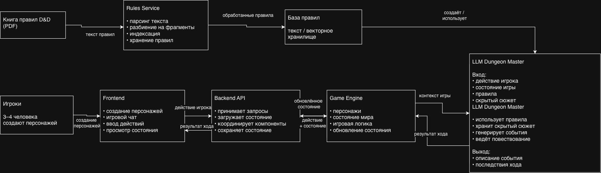
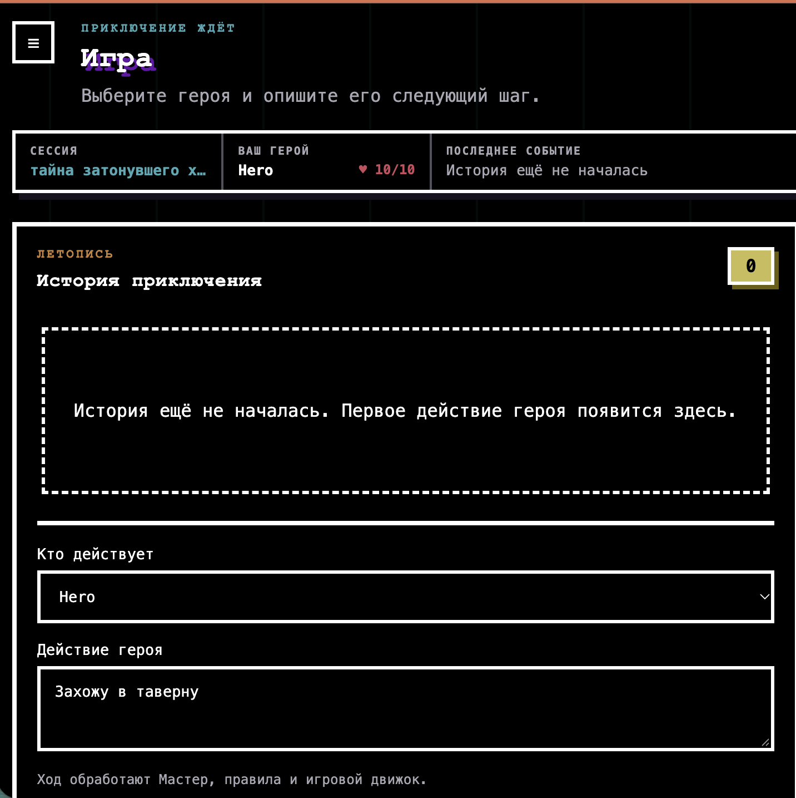

# AI Dungeon Master

AI Dungeon Master — веб-приложение для текстовой настольной RPG с LLM в роли ведущего. Игрок создаёт игровую сессию, отправляет действия персонажа и получает повествование и обновлённое состояние мира.

> **Статус:** Frontend, Backend, Game Engine и оркестратор объединены в рабочий прототип. Сессии, персонажи и история сохраняются в SQLite. Для ходов с реальной LLM требуется доступный API-провайдер и квота.

## Архитектура



```text
Browser / Frontend
       |
       v
Backend (FastAPI, sessions, state, history)
       |
       v
TurnOrchestrator
  |        |             |
  v        v             v
Rules   AI Dungeon    Game Engine
Service    Master     (validation and state updates)
```

- **Frontend:** браузерный интерфейс на HTML/CSS/JavaScript; создание и выбор сессии, отправка ходов, отображение персонажей, мира и истории.
- **Backend / Application:** REST API, создание сессий, хранение состояния и истории в SQLite, координация компонентов.
- **TurnOrchestrator:** проверка действия, запрос релевантных правил, вызов Dungeon Master, преобразование ответа в команды Game Engine.
- **AI Dungeon Master:** генерация повествования и структурированных последствий хода через OpenAI-совместимый API.
- **Rules Service:** извлечение правил из локального документа; режим `keyword` позволяет обойтись без загрузки embedding-модели.
- **Game Engine:** детерминированное применение структурированных команд, валидация, обновление характеристик и игрового мира.

## Игровой ход

1. Игрок отправляет действие через Frontend.
2. Backend находит сессию и создаёт `PlayerAction` с ожидаемой ревизией состояния.
3. Оркестратор получает правила, а AI Dungeon Master либо завершает безопасное действие, либо предлагает характеристику и DC проверки.
4. Для рискованного действия Backend возвращает `202 awaiting_roll`. Значение d20 создаёт только Game Engine через системный источник случайности.
5. После броска AI получает неизменяемый результат `d20 + modifier` и описывает соответствующие последствия. Возможна цепочка до трёх проверок; первый провал завершает её.
6. Game Engine проверяет исход и атомарно применяет HP, инвентарь и локацию только после завершения цепочки.
7. Один принятый ход увеличивает номер хода и ревизию ровно один раз, а события проверок предшествуют событиям изменения состояния.

Если Rules Service недоступен, оркестратор может продолжить ход без дополнительных правил. Если AI Dungeon Master не отвечает, ход завершается ошибкой, а состояние не сохраняется как успешное.

## Локальный запуск

Требуется Python 3.13 (используемая в разработке версия). Frontend не требует сборки.

```bash
python3 -m venv .venv
source .venv/bin/activate
python -m pip install -r requirements.txt
cp .env.example .env
```

Укажите в `.env` собственный ключ провайдера (`OPENAI_API_KEY`). **Не добавляйте `.env` и токены в Git.** Для Hugging Face Router нужны доступная модель и квота Inference Providers.

Запуск Backend:

```bash
uvicorn backend.main:app --reload --port 8000
```

В отдельном терминале запустите Frontend:

```bash
python -m http.server 5500 --directory frontend
```

Откройте `http://127.0.0.1:5500`. Если в вашей ветке есть `run.sh`, можно использовать его вместо двух терминалов после проверки содержимого скрипта.

## Конфигурация

| Переменная | Назначение |
|---|---|
| `OPENAI_API_KEY` | Ключ OpenAI-совместимого API (например, Hugging Face) |
| `OPENAI_BASE_URL` | URL API провайдера |
| `MODEL_NAME` | Идентификатор модели |
| `RULES_BOOK_PATH` | Путь к документу правил |
| `RULES_MODE` | Режим поиска правил (`keyword` для локальной разработки) |

Образец настроек: [`.env.example`](.env.example). Указанная там модель — пример конфигурации; её доступность зависит от провайдера и квоты.

## API

| Метод | Путь | Назначение |
|---|---|---|
| `GET` | `/health` | Проверка доступности Backend |
| `POST` | `/sessions` | Создание сессии (`name`) |
| `GET` | `/sessions/{session_id}/state` | Публичное состояние сессии |
| `POST` | `/sessions/{session_id}/characters` | Создание персонажа в сессии |
| `POST` | `/sessions/{session_id}/turns` | Игровой ход (`character_id`, `text`) |
| `POST` | `/sessions/{session_id}/turns/{action_id}/roll` | Зафиксировать или безопасно повторить бросок ожидающей проверки |
| `POST` | `/sessions/{session_id}/turns/{action_id}/cancel` | Отменить проверку до первого броска |
| `POST` | `/sessions/{session_id}/actions` | Техническое применение изменения HP (`character_id`, `text`, `health_delta`) |

Интерактивная документация FastAPI: `http://127.0.0.1:8000/docs`.

## Тестирование

```bash
python -m unittest discover -s engine/tests -p 'test_*.py' -v
python -m unittest discover -s ai_dm/tests -p 'test_*.py' -v
python -m unittest discover -s backend/tests -p 'test_*.py' -v
python -m unittest discover -s integration/tests -p 'test_*.py' -v
```

Тесты Frontend (если установлен Node.js):

```bash
npm run test:frontend
```

## Текущие ограничения

- Для реальных ответов Dungeon Master требуется OpenAI-совместимый API. Можно использовать внешний провайдер или локальный Ollama; модель должна поддерживать JSON Schema.
- Нет авторизации и полноценной многопользовательской синхронизации между браузерами.
- SQLite рассчитан на локальный однопроцессный запуск, а не на распределённое развёртывание.
- Скрытый сюжет и внутренние заметки Dungeon Master не должны передаваться в публичный ответ Frontend.
- Старые сессии сохраняются, но проверку навыков следует проверять в новой сессии с шестью характеристиками.

## Документация

- [Техническая реализация компонентов](docs/implementation.md)
- [Backend и работа приложения](docs/backend_application.md)


## Как играть

1. Откройте игровой интерфейс в браузере.
2. Перейдите в раздел **«Сессия»** через боковое меню.
3. Создайте новую игровую сессию, указав название приключения.
4. В разделе **«Герои»** добавьте персонажа или оставьте стартового героя.
5. Перейдите в раздел **«Игра»** и выберите действующего персонажа.
6. Опишите действие, например: `Захожу в таверну и спрашиваю трактирщика о пропавших путешественниках`.
7. Отправьте действие. Для рискованного действия появится карточка с характеристикой, DC, шансом успеха и кнопкой **«Бросить d20»**.
8. После броска дождитесь фиксации кубика. Итоговая формула, повествование и изменения состояния появятся после ответа Мастера.

Дополнительные разделы интерфейса:

- **Игра** — отправка действий и история приключения.
- **Герои** — характеристики, здоровье и инвентарь персонажей.
- **Мир** — текущее местоположение и информация об игровом мире.
- **Сессия** — создание, подключение и переключение игровых сессий.

### Пример игрового интерфейса



*Экран игры: выбранный персонаж, летопись приключения и форма отправки следующего действия.*

## Команда

| Участник | Зона ответственности |
|---|---|
| Наталья | Backend / Application |
| Денис | Game Engine, Frontend |
| Егор | AI Dungeon Master |
| Сергей | Rules Service, интеграция компонентов |

## Статус проекта

Рабочий прототип поддерживает создание и восстановление сессий, создание персонажей, игровые ходы, сохранение состояния и публичной летописи.
